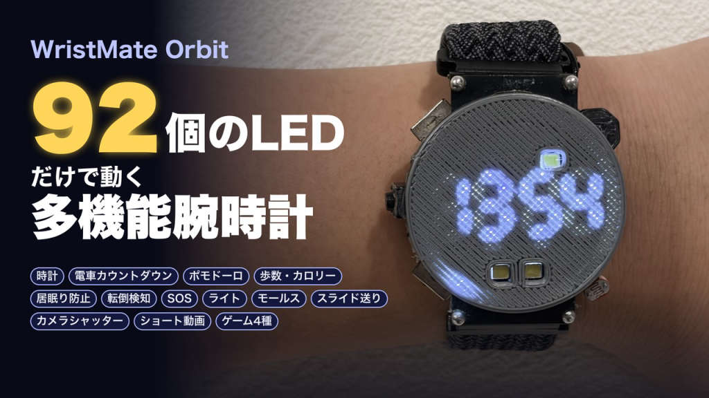

# WristMate_Orbit

画面を持たない自作スマートウォッチ。外周60個と7セグ4桁などのLED(計92個)と振動だけで表示し、ダイヤル(ロータリーエンコーダ)1つと腕の動きで操作する。



## 中身

```
firmware/WristMate_Orbit/   Arduino スケッチ(本体)
hardware/v5_XIAO-ESP32S3_Encoder/  基板 v5(現行)。マイコンは Seeed XIAO ESP32-S3、ロータリーエンコーダ付き
hardware/v4_ESP32-C3-SuperMini/  基板 v4(旧版)。マイコンは ESP32-C3 SuperMini
```

各 `hardware/` には KiCad プロジェクト(`.kicad_pro` / `.kicad_sch` / `.kicad_pcb`)が入っている。v4 には JLCPCB 発注用のガーバー・BOM・CPL(`jlcpcb/`)もある。v5 のガーバーは KiCad から出力する。

**現行のファームウェアは v5(XIAO ESP32-S3)用。** v4 基板ではピン割り当てが違うのでそのままでは動かない。

## 主な機能

- 時計・歩数・ポモドーロ・カウンター・タイマー
- 電車の発車までの残り時間(サブLEDの色で、間に合うかが分かる)
- モールス符号の練習(光と振動)、ライト(16段階調光)、SOS点滅
- 手首を上げると点灯・下ろすと消灯、転倒検知(起きている間 / スリープ中)
- 居眠り防止(ディープスリープのまま定期的に動きを確認)
- BLE キーボード/マウス: スライド送り、ショート動画送り、カメラのシャッター
- ゲーム4種(擬似重力・金庫破り・モグラ叩き・ハイ&ロー)
- スマホのブラウザから設定(Wi-Fi の設定画面。アプリ不要)

メニューは `WristMate_Orbit.ino` の `MENU_LIST` から作られる。1行足して動作を書けば、機能を追加できる。

## ハードウェア(v5)

| 部品 | 役割 |
|---|---|
| Seeed XIAO ESP32-S3 | マイコン |
| IS31FL3733 | LED ドライバ(I2C) |
| BMA400 | 加速度センサー(手首起床・歩数・タップ・転倒) |
| RV-3028 | RTC |
| ロータリーエンコーダ(押しボタン付き) | 操作 |
| 振動モーター / COB LED / CdS | 振動・ライト・明るさ検知 |

ピン: D0=加速度 INT1, D1=COB, D2=LED ドライバ EN, D3=SDA, D4=SCL, D5=振動, D6/D7=エンコーダ A/B, D8=CdS, D9=RTC INT, D10=スイッチ

## ビルド

- Arduino IDE または arduino-cli。ボード: `esp32:esp32:XIAO_ESP32S3`(Arduino-ESP32 3.x)
- 必要なライブラリ
  - ESP32Encoder
  - SparkFun BMA400 Arduino Library
- BLE キーボードは `src/HijelHID_BLEKeyboard/` に同梱(Apache-2.0。ライセンスは同フォルダの `LICENSE`)

```sh
arduino-cli compile -b esp32:esp32:XIAO_ESP32S3 firmware/WristMate_Orbit
```

## 設定画面

メニューの SETTING を開くと、時計が Wi-Fi の親機になる。スマホで接続するとブラウザに設定画面が出る。

- SSID: `WristMate-Orbit` / パスワード: `orbit1234`(`OrbitConfig.h` の `OC_AP_PASS`)。**自分用に作るときは変えること。**
- メニューの順番と表示、時刻表(駅A/駅Bの平日・休日)、スリープまでの時間、時刻合わせなどを変えられる。
- 内蔵の時刻表はサンプル。実際の時刻表は設定画面から貼り付ける。

## ライセンス

| 対象 | ライセンス |
|---|---|
| `firmware/`(プログラム) | [MIT](LICENSE) |
| `hardware/`(回路図・基板)、`docs/images/`(画像) | [CC BY 4.0](hardware/LICENSE) |
| `firmware/WristMate_Orbit/src/HijelHID_BLEKeyboard/` | Apache-2.0(同フォルダの `LICENSE`。元の作者のもの) |

自由に使い、改造し、配布してよい。その際は作者名(Hinata)とライセンスを表示すること。

© 2026 Hinata
